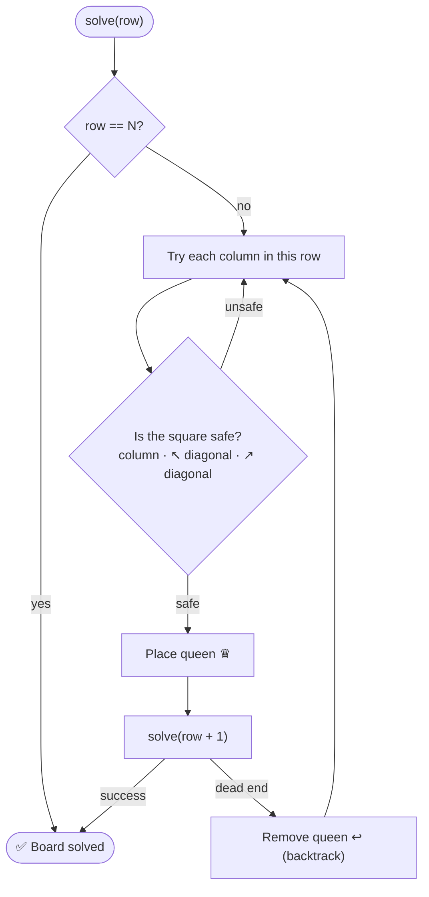

<div align="center">

# ♛ N-Queens Visualiser

**Watch backtracking happen in real time — place N queens on an N×N board so that no two attack each other, and see every valid arrangement drawn step by step.**

[](https://n-queen-visualiser-topaz.vercel.app)


[The Problem](#-the-problem) · [Algorithm](#-the-algorithm) · [Features](#-features) · [How to Use](#-how-to-use) · [Getting Started](#-getting-started)

</div>

---

## 🧩 The Problem

Place **N** queens on an **N × N** chessboard so that no two queens threaten each other — no two share the same **row**, **column** or **diagonal**.

<details>
<summary><b>📊 How many solutions exist?</b></summary>

<br/>

| N | 1 | 2 | 3 | 4 | 5 | 6 | 7 | 8 |
|---|---|---|---|---|---|---|---|---|
| **Solutions** | 1 | 0 | 0 | 2 | 10 | 4 | 40 | 92 |

</details>

## 🧠 The Algorithm

The visualiser uses **recursive backtracking**, highlighting every check on the board:



## ✨ Features

- ♛ **Interactive visualisation** of the N-Queens problem
- 🔢 **Choose the board size** — from 1 up to 8 queens
- 🎚️ **Speed slider** to slow down or speed up the animation
- 🧮 **All arrangements** — every valid board for the chosen N is drawn
- 🎨 **Colour-coded checks** for safe and attacked squares while backtracking
- 📱 **Responsive** on desktop and mobile

## 🎮 How to Use

1. Enter the **number of queens** (1–8).
2. Use the **slider** to set the visualisation speed.
3. Click **Play** to start.
4. Watch each board fill in as the algorithm explores and backtracks.

## 🚀 Getting Started

No build step — it's plain HTML, CSS and JavaScript.

```bash
git clone https://github.com/Shariq2003/N-Queen-Visualiser.git
cd N-Queen-Visualiser
# open index.html in your browser, or serve it:
npx serve .
```

<details>
<summary><b>📁 Project structure</b></summary>

```text
N-Queen-Visualiser/
├── index.html   # layout, controls
├── index.css    # board & UI styles
└── chess.js     # Queen class: solveQueen, isValid, delay, clearColor
```

</details>

## 🤝 Contributing

Contributions are welcome!

1. Fork the repository
2. Create a branch: `git checkout -b feature/YourFeature`
3. Commit: `git commit -m "Add some feature"`
4. Push: `git push origin feature/YourFeature`
5. Open a Pull Request

---

<div align="center">

Built by **[Shariq](https://github.com/Shariq2003)** · [LinkedIn](https://www.linkedin.com/in/shariq-sd)

⭐ If you like this project, consider giving it a star!

</div>
